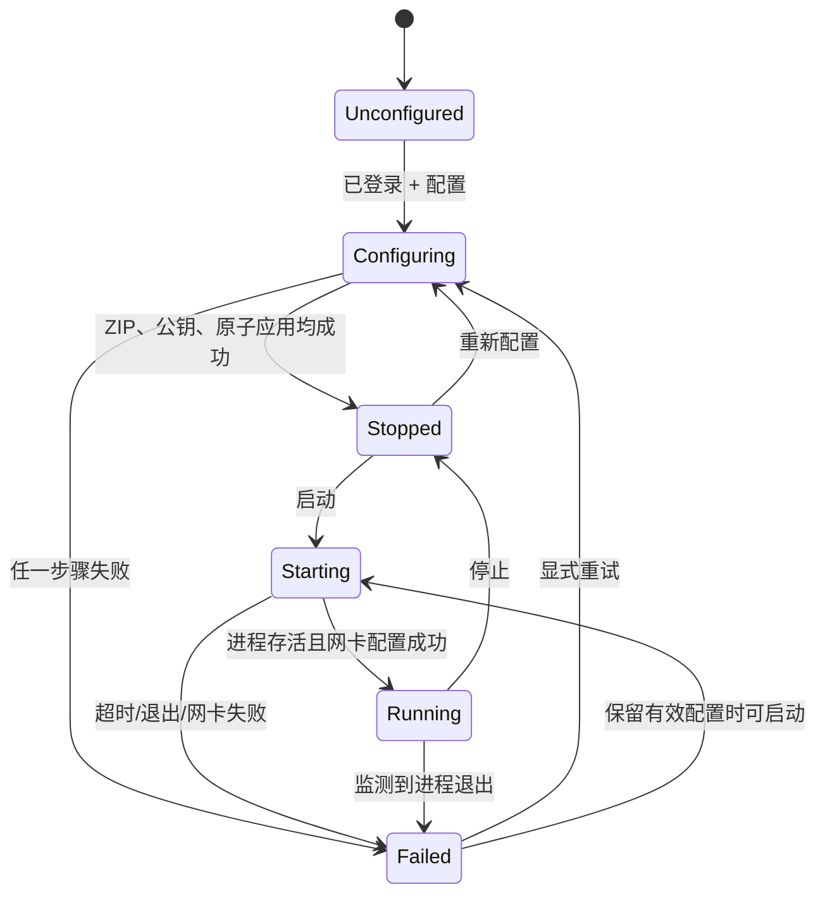

# 架构与状态

Vue 3/TypeScript/Vite → Tauri 2 Rust command → 有界 IPC → Rust vpn-agent → vpn-core → 后端 API / 受控文件 / Tinc。

- `apps/desktop`：普通用户界面，只注册 login/configure/start_vpn/stop_vpn/get_status/get_recent_logs/logout。无 shell/fs 插件，无私钥接口。
- `crates/vpn-core`：真实 API、会话、RSA、ZIP 校验、版本化配置、进程状态机。无前端模拟数据。
- `crates/vpn-ipc`：生产端点固定；Debug E2E 可使用仅含字母、数字、`-`、`_` 的受限实例后缀隔离端点。协议为网络字节序 u32 长度前缀 JSON，单帧最多 64 KiB，并校验服务端身份。
- `apps/agent`：可执行的后台 Agent。`main.rs` 负责启动，`server.rs` 负责 IPC 监听和请求分发，`service/` 负责 Windows Service 与 Linux/systemd 进程生命周期；单配置文件锁，最多 16 个 IPC 连接，一个写操作，状态读取不会被网络请求阻塞。
- `crates/platform-windows`：SDDL、服务进程 SID 校验。`crates/platform-linux`：UID 校验、socket 权限。

## 状态

WaitingApproval 为协议预留状态，当前没有可证明的后端判据，**不会通过猜测响应进入或离开该状态**。当前 `confirmation=unavailable`。Running 只表示子进程运行；Agent 从经过严格校验并已落盘的 `hosts/server_master` 取得唯一 `/32` Subnet，为该地址创建经专用接口的 active 路由，再每 5 秒执行一次 ICMP 探测。只有探测成功才设置 `connection=connected`；失败为 `unreachable`，探测工具不可用或未运行时为 `unknown`。

## 配置与恢复

身份由服务根地址+net_name+sid 的 SHA-256 隔离。根目录包含 `keys/<hash>/rsa_key.priv`、`generations/gen-*/{tinc.conf,hosts,rsa_key.priv}`、`active.json`、`adapter-state.json` 和进程锁。私钥文件原子写入，坏私钥不自动覆盖。下载包在内存限额内解压校验，文件仅写全新的临时版本目录；全部成功后提交版本并原子替换 active.json。配置操作要求 VPN 已停止。失败保留旧 active.json 与有效配置；成功后的旧版本暂保留，需维护磁盘使用量。

UI 重开从服务读取真实状态；UI 退出不停止服务。服务重启读取有效配置并显示已停止，不根据 PID 文件杀进程、不在会话失效后自动重新登录。Token 只保存在服务内存中，因此 UI 重启会话仍在，服务重启需重新登录；本地有效配置仍可启动。

## 超时和并发

HTTP 连接 5 秒、整个单次请求 20 秒；没有自动重试；用户显式重试。下载上限 4 MiB，解压总计 2 MiB、128 项、每文件 64 KiB。密钥工作进程 60 秒且超时终止，Tinc 版本查询 5 秒、启动观察 2 秒、网卡步骤各 10 秒、停止 10 秒。IPC 读首帧 5 秒、写回 5 秒、客户端等候 150 秒。重复写操作立即 busy；已有 start/stop 在相应状态为幂等。状态监视每秒检查子进程。操作被 UI 断线打断时服务仍完成当前事务，重开读取最终状态。

## 平台边界

Windows 服务账户 LocalSystem，数据目录 ACL 仅 SYSTEM/Administrators，pipe 授权特定交互用户 SID；UI 不提权。管理员安装独立服务和 Tinc/TAP，运行期 UI 不触发任意提权命令。Linux root 服务、受保护数据目录、socket 0600 授权指定 UID，systemd KillMode=control-group。

当前只实现单台机器一个活动网络/一个授权用户。网卡名由管理员设置。后端已确认 IP 固定按 `node_ip/32` 设置，开发和新安装设置显式写入此前缀。Agent 只为 `server_master` 的已校验 `/32` Subnet 创建一条 active 路由；没有后端网段契约，因此不会猜测 `/24`，也未自动创建其他节点路由、DNS 或防火墙规则。停止、启动中失败、Tinc 异常退出或服务正常关闭时，Agent 会删除本次设置的精确对端路由和本机 `/32` 地址；Windows 使用 active store 并保留专用 TAP，Linux 随后将本次触碰的专用接口置 down。

成功设置地址或路由后，Agent 会原子写入受保护的 `adapter-state.json`，记录当前活动配置的 generation/profile、管理员设置的专用接口、精确地址/前缀及由当前 `server_master` 导出的精确路由；Linux 还记录是否触碰 link 状态。旧版不含 `routes` 字段的记录仍可用于地址恢复。Agent 重启时只有记录与当前设置、`active.json` 和当前服务端目标完全一致才自动清理，否则以 `adapter_state_invalid` 拒绝猜测性操作。清理失败保留记录并允许再次停止重试；清理完成才删除记录。在系统命令成功与恢复记录落盘之间仍存在极短的进程强杀窗口，真实 TAP/TUN 路由生命周期仍需实机故障注入验收。
